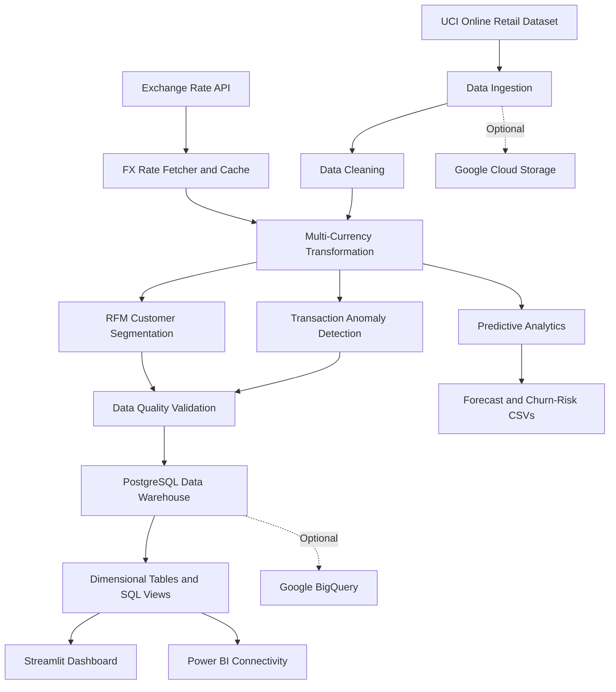

# FinanceETL — Financial Data Engineering Platform

An end-to-end data engineering project that transforms raw retail transaction data into analytics-ready datasets. The platform demonstrates ETL pipeline development, data cleaning, multi-currency revenue calculations, customer segmentation, anomaly detection, dimensional data warehousing, predictive analytics, and interactive dashboards.

Built with Python, PostgreSQL, SQLAlchemy, pandas, scikit-learn, Streamlit, and optional Google Cloud integrations.

---

## Table of Contents

- [Project Overview](#project-overview)
- [Architecture](#architecture)
- [Key Features](#key-features)
- [Technology Stack](#technology-stack)
- [Project Structure](#project-structure)
- [Data Pipeline](#data-pipeline)
- [Data Warehouse Design](#data-warehouse-design)
- [Analytics and Business Intelligence](#analytics-and-business-intelligence)
- [Installation and Setup](#installation-and-setup)
- [Configuration](#configuration)
- [Running the Application](#running-the-application)
- [Data Quality and Testing](#data-quality-and-testing)
- [Google Cloud Integration](#google-cloud-integration)
- [Apache Airflow](#apache-airflow)
- [Known Limitations](#known-limitations)
- [Future Improvements](#future-improvements)
- [License](#license)

---

## Project Overview

Financial and retail transaction data often requires extensive preparation before it can support reliable business decisions. Inconsistent records, multiple currencies, customer purchasing patterns, and unusual transactions can make analysis difficult.

**FinanceETL** addresses these challenges through a modular data pipeline that extracts retail transaction data, cleans and enriches it, calculates analytical metrics, and loads the results into a relational data warehouse.

The project uses the UCI Online Retail dataset and provides an end-to-end demonstration of data engineering concepts, from source ingestion to business intelligence.

### Project objectives

- Build a modular ETL pipeline for retail transaction data.
- Automate data ingestion and foreign exchange rate retrieval.
- Implement data cleaning, validation, and transformation.
- Design a dimensional data warehouse using a star-schema approach.
- Perform customer segmentation using Recency, Frequency, and Monetary analysis.
- Identify potentially suspicious transactions using explainable rules.
- Generate baseline sales forecasts and customer churn-risk scores.
- Visualize business performance through an interactive dashboard.
- Explore optional cloud data storage and analytical processing with Google Cloud.

## Architecture

The platform separates ingestion, transformation, analytics, storage, and visualization into dedicated components.



### Architecture layers

| Layer | Responsibility |
|---|---|
| Ingestion | Loads retail datasets and retrieves exchange rates. |
| Transformation | Cleans records, calculates revenue, and enriches transactions. |
| Analytics | Generates customer segments, anomaly flags, and predictive outputs. |
| Data quality | Checks required fields, invalid values, dates, and currency calculations. |
| Data warehouse | Stores analytical data in PostgreSQL tables. |
| Visualization | Presents KPIs, customer segments, and analytical results. |
| Cloud integration | Provides optional Google Cloud Storage and BigQuery loading paths. |

## Key Features

### 1. Automated Data Ingestion

The ingestion layer is implemented in `src/ingestion/`.

- Loads Excel and CSV datasets from supported local directories.
- Downloads the default Online Retail dataset when no supported local files are found.
- Combines discovered datasets and removes exact duplicate rows.
- Retrieves exchange rates through ExchangeRate-API.
- Caches exchange rates locally to reduce unnecessary API requests.

### 2. Data Cleaning and Transformation

The transformation layer prepares raw records for downstream analytics.

Implemented operations include:

- Removing rows with missing invoice or customer identifiers.
- Filtering non-positive quantities and unit prices for sales-focused analysis.
- Removing duplicate records.
- Standardizing customer identifiers and invoice dates.
- Normalizing selected text fields.
- Calculating transaction-line revenue.
- Generating additional currency-denominated revenue columns.

The transformation logic is organized into reusable Python classes rather than being concentrated in a single script.

### 3. Change Data Capture Simulation

The project includes a batch-based CDC simulator in `src/ingestion/cdc_simulator.py`.

It sorts transactions chronologically and divides the dataset into two batches:

- **Initial batch:** the first 80% of records.
- **Incremental batch:** the remaining 20%.

Both batches are processed by the pipeline to demonstrate an initial load followed by an incremental batch.

This is a CDC simulation, not a connector that detects actual database changes or captures source-level updates and deletes.

### 4. Multi-Currency Revenue Calculation

The currency transformation module calculates transaction revenue using GBP as the base currency.

For each transaction:

`Total_GBP = Quantity × UnitPrice`

Converted values are calculated as:

`Total_Currency = Total_GBP × ExchangeRate`

The supported output currencies are:

- GBP — British Pound
- USD — US Dollar
- EUR — Euro
- MAD — Moroccan Dirham

The FX fetcher uses cached or retrieved rates and includes fallback development rates.

**Important:** The current implementation uses latest available rates rather than historical exchange rates corresponding to each transaction date.

### 5. Customer Segmentation with RFM Analysis

The RFM module groups purchasing behavior by customer.

| Metric | Description |
|---|---|
| Recency | Number of days since the customer's latest purchase, relative to the dataset's reference date. |
| Frequency | Number of distinct invoices associated with the customer. |
| Monetary | Total customer spending in GBP. |

Customers receive quantile-based scores that are combined into an RFM score and a descriptive segment.

Current segment labels include:

- Best Customers
- Loyal Customers
- Big Spenders
- Potential Loyalists
- Lost Customers
- At Risk
- Recent Customers

These segments can support customer analysis, retention planning, and marketing decisions.

### 6. Transaction Anomaly Detection

The fraud detection module implements three rule-based screening methods.

**Transaction value outliers**

Flags transactions whose GBP value exceeds a threshold based on the interquartile range:

`Upper Threshold = Q3 + 3 × IQR`

**Product price anomalies**

Flags item prices that exceed twice the observed average price for the corresponding stock code.

**Transaction velocity**

Flags transactions belonging to customers with more than ten distinct invoices on the same calendar day.

The resulting `Is_Fraud_Suspect` field identifies records that match at least one rule.

These rules are intended for exploratory anomaly screening. A flagged transaction is not necessarily fraudulent, and the implementation is not a validated fraud detection model.

### 7. Predictive Analytics

The project includes two baseline analytical components in `src/analytics/predictive.py`.

**Revenue forecasting**

A linear regression model learns the relationship between historical daily revenue and calendar date. It then generates a daily revenue forecast for a future period.

The default forecast horizon is 30 days.

Output:

`data/processed/sales_forecast.csv`

**Customer churn-risk scoring**

The churn-risk component calculates a heuristic score using customer RFM recency and frequency scores. Customers above the configured threshold are included in the high-risk output.

Output:

`data/processed/churn_risk.csv`

These outputs demonstrate predictive analytics workflows but have not been established as validated forecasting or churn-prediction models.

### 8. Data Quality Validation

The quality module checks transformed data before warehouse loading.

Current checks include:

- Null values in critical columns.
- Non-positive quantities and revenue.
- Future transaction dates.
- Selected currency conversion integrity conditions.
- Duplicate invoice and product combinations, which generate warnings.

Critical failures prevent the normal pipeline from proceeding to warehouse loading.

### 9. Interactive Dashboard

The Streamlit dashboard provides an interface for exploring the warehouse and generated analytical outputs.

Available visualizations include:

- Total revenue in GBP.
- Total number of orders.
- Total number of customers.
- Average order value.
- Revenue by country.
- Customer distribution by RFM segment.
- Sales forecast visualization.
- High-risk customer tables.

Plotly is used to render interactive charts.

---

## Technology Stack

| Category | Technologies |
|---|---|
| Programming language | Python |
| Data processing | pandas, NumPy |
| API integration | requests, ExchangeRate-API |
| Configuration | python-dotenv, Pydantic Settings |
| Logging | Loguru |
| Database | PostgreSQL |
| ORM and database access | SQLAlchemy, psycopg2 |
| Analytics | scikit-learn |
| Dashboard | Streamlit, Plotly |
| Cloud services | Google Cloud Storage, BigQuery |
| Testing | pytest |
| Containerization | Docker, Docker Compose |
| Workflow orchestration | Apache Airflow integration |
| Automation | GNU Make |

## Project Structure

```text
FinanceETL/
├── config/
│   ├── logging_config.py
│   └── settings.py
├── data/
│   ├── raw/
│   └── processed/
├── dags/
│   └── finance_etl_dag.py
├── dashboards/
│   ├── app.py
│   └── powerbi/
│       └── README.md
├── gcp/
│   └── README.md
├── sql/
│   ├── postgresql/
│   │   ├── init_schema.sql
│   │   └── views.sql
│   └── bigquery/
│       └── init_schema_bq.sql
├── src/
│   ├── analytics/
│   │   └── predictive.py
│   ├── ingestion/
│   │   ├── csv_loader.py
│   │   ├── fx_api.py
│   │   └── cdc_simulator.py
│   ├── transformation/
│   │   ├── cleaner.py
│   │   ├── currency.py
│   │   ├── rfm.py
│   │   └── fraud.py
│   ├── quality/
│   │   └── checks.py
│   └── warehouse/
│       ├── models.py
│       ├── loader.py
│       └── gcp_loader.py
├── tests/
│   └── test_transformation.py
├── main.py
├── Makefile
├── docker-compose.yml
├── requirements.txt
├── .env.example
├── FINAL_REPORT.md
└── README.md
```

## Data Pipeline

The main orchestrator is `main.py`.

### Pipeline execution sequence

1. **Ingestion:** Load the retail dataset and retrieve exchange rates.
2. **Cleaning:** Remove invalid records, standardize fields, and eliminate duplicates.
3. **Transformation:** Calculate revenue in multiple currencies.
4. **Customer analytics:** Generate RFM metrics and customer segments.
5. **Anomaly screening:** Add transaction-level suspect flags.
6. **Validation:** Run data quality checks.
7. **Warehouse loading:** Load dimension and fact records into PostgreSQL.
8. **Reporting:** Query the warehouse through SQL views and the dashboard.
9. **Predictive analytics:** Optionally generate sales forecasts and churn-risk reports.

## Data Warehouse Design

The warehouse uses a dimensional modeling approach with separate dimension tables and a transaction fact table.

### Dimension tables

**`dim_date`**

Contains calendar attributes:

- Date key
- Full date
- Day name
- Month name and number
- Quarter
- Year
- Weekend indicator

**`dim_customer`**

Stores customer attributes and current RFM profiles:

- Customer key
- Country
- RFM segment
- RFM score
- Validity timestamps
- Current-record indicator

**`dim_product`**

Stores product information:

- Product key
- Description
- Unit price in GBP

### Fact table

**`fact_sales`**

Stores transaction-line measures:

- Sales identifier
- Invoice number and date
- Customer key
- Product key
- Quantity
- Unit price
- Revenue in GBP, USD, EUR, and MAD
- Suspect transaction indicator

### Analytical SQL views

The PostgreSQL views in `sql/postgresql/views.sql` include:

| View | Purpose |
|---|---|
| `v_sales_by_country` | Summarizes orders and revenue by country. |
| `v_customer_profiles` | Exposes current customer segmentation information. |
| `v_fraud_report` | Lists transactions flagged by the anomaly rules. |

The warehouse supports downstream analysis through SQL clients and BI tools.

## Analytics and Business Intelligence

The platform supports several business questions.

**Revenue analysis**
- How much revenue was generated?
- Which countries contribute the most revenue?
- How does order value vary?

**Customer analytics**
- Which customers have high RFM scores?
- Which customers may require retention campaigns?
- How are customers distributed across segments?

**Transaction monitoring**
- Which transactions have unusually high values?
- Which product prices deviate from observed averages?
- Which customers show unusually high daily invoice activity?

**Predictive analysis**
- What does a baseline future revenue trend look like?
- Which customers receive high heuristic churn-risk scores?

---

## Installation and Setup

### Prerequisites

Install the following before starting:

- Python and pip.
- Docker with Docker Compose.
- Git.
- GNU Make, if you want to use the provided Makefile shortcuts.

Python 3.10 or later is a reasonable starting point; verify compatibility with the installed dependencies.

### 1. Clone the repository

```bash
git clone https://github.com/adamfutur/FinanceETL.git
cd FinanceETL
```

### 2. Create a virtual environment

Linux/macOS:

```bash
python -m venv .venv
source .venv/bin/activate
```

Windows PowerShell:

```powershell
python -m venv .venv
.venv\Scripts\Activate.ps1
```

### 3. Install dependencies

```bash
python -m pip install --upgrade pip
pip install -r requirements.txt
```

### 4. Configure environment variables

Linux/macOS:

```bash
cp .env.example .env
```

Windows PowerShell:

```powershell
Copy-Item .env.example .env
```

Update `.env` with the relevant local settings and API credentials.

### 5. Start PostgreSQL

```bash
docker-compose up -d
```

Check that the container is running:

```bash
docker-compose ps
```

The included Compose configuration exposes PostgreSQL on port `5432` and creates the `finance_db` database.

The default credentials are intended for local development only.

### 6. Execute the ETL pipeline

```bash
python main.py --step full
```

Alternatively, use:

```bash
make etl
```

The full mode runs ingestion, transformations, quality validation, and warehouse loading.

---

## Configuration

Environment settings are documented in `.env.example` and defined in `config/settings.py`.

| Variable | Description |
|---|---|
| `EXCHANGE_RATE_API_KEY` | ExchangeRate-API key. |
| `BASE_CURRENCY` | Base currency used for exchange rate retrieval; defaults to GBP. |
| `POSTGRES_USER` | PostgreSQL username. |
| `POSTGRES_PASSWORD` | PostgreSQL password. |
| `POSTGRES_DB` | Database name. |
| `POSTGRES_HOST` | Database hostname. |
| `POSTGRES_PORT` | Database port. |
| `GCP_PROJECT_ID` | Google Cloud project ID. |
| `GCP_DATASET_ID` | BigQuery dataset ID. |
| `GCP_BUCKET_NAME` | Google Cloud Storage bucket name. |
| `GCP_SERVICE_ACCOUNT_JSON` | Service-account JSON path read by the current GCP loader. |
| `LOG_LEVEL` | Intended application logging level. |

The current GCP loader reads `GCP_SERVICE_ACCOUNT_JSON` directly from the environment. Follow that variable when configuring its credential path.

**Security:** Never commit `.env`, service-account JSON files, passwords, or API keys to GitHub.

## Running the Application

### Full ETL pipeline

```bash
python main.py --step full
```

### CDC simulation

```bash
python main.py --step cdc
```

This runs the initial and incremental batch simulation.

### Predictive analytics

```bash
python main.py --step predict
```

This generates the sales forecast and churn-risk CSV files under `data/processed/`.

### Launch the dashboard

```bash
python main.py --step dashboard
```

Alternatively:

```bash
make dashboard
```

The dashboard expects the warehouse to be populated and uses a local PostgreSQL connection configured directly in `dashboards/app.py`.

### Stop PostgreSQL

```bash
docker-compose down
```

This stops the container while preserving its named database volume.

## Data Quality and Testing

Run the tests directly using pytest:

```bash
pytest
```

The existing tests cover:

- Removal of negative-quantity transactions.
- Currency revenue calculations.
- RFM segment generation.
- A transaction anomaly detection case.

These tests provide an initial level of verification for transformation logic.

**Note:** The current `make test` target calls `main.py --step test`, but `test` is not among the supported CLI modes. Use `pytest` directly until that shortcut is corrected.

Additional integration tests would be useful for database loading, API failures, repeated ETL execution, and cloud uploads.

## Google Cloud Integration

Optional cloud functionality is implemented in `src/warehouse/gcp_loader.py`.

### Google Cloud Storage

The loader includes a method to upload a raw dataset to a configured Google Cloud Storage bucket.

### BigQuery

The loader includes methods for uploading analytical data to BigQuery. A schema definition is provided in:

`sql/bigquery/init_schema_bq.sql`

Before using the cloud integration:

1. Create a Google Cloud project.
2. Enable the required APIs.
3. Configure a storage bucket and BigQuery dataset.
4. Create a service account with appropriate permissions.
5. Set the GCP environment variables.
6. Replace the placeholder project and dataset references in the BigQuery DDL.
7. Validate the warehouse schema mappings and load behavior against your environment.

The cloud integration is optional and requires environment-specific configuration and testing. It should not be assumed to be a fully deployed production data platform.

## Apache Airflow

The repository includes a DAG definition at:

`dags/finance_etl_dag.py`

The intended workflow is:

```text
ingest_data
     |
     v
transform_and_analyze
     |
     v
load_to_data_warehouse
```

The DAG is intended to demonstrate task dependencies and scheduled pipeline execution.

**Configuration required:** The current DAG contains a machine-specific Windows path. It also uses separate pipeline modes that do not currently exchange persisted intermediate datasets. Update the paths, Python environment, and task design before running it in an Airflow deployment.

Airflow must be installed and configured separately; it is not included in `requirements.txt`.

## Known Limitations

This project is a data engineering portfolio project and has several areas for further improvement.

- **Simulated CDC:** Batch partitioning is implemented, but real inserts, updates, and deletes are not captured from a source change log.
- **Repeated loads:** Fact records are appended without a demonstrated idempotent transaction-key strategy. Repeated runs can create duplicate facts.
- **Historical currency rates:** The pipeline uses latest available rates rather than transaction-date exchange rates.
- **Rule-based anomaly detection:** The flags are screening heuristics, not confirmed fraud labels.
- **Baseline forecasting:** The linear regression approach does not demonstrate holdout evaluation, seasonal modeling, or prediction intervals.
- **Cloud deployment:** GCP credentials, schema mappings, IAM permissions, and infrastructure need environment-specific validation.
- **Airflow portability:** The current DAG includes a local machine path and needs deployment changes.
- **Local database configuration:** Default credentials are for development and should not be reused in a deployed environment.
- **Hard-coded ingestion path:** The loader contains an additional Windows directory that should be removed or made configurable for portable execution.
- **Test shortcut:** The Makefile test command needs correction to invoke pytest.

## Future Improvements

Potential next steps include:

- Implement idempotent fact loading and stable transaction-line identifiers.
- Add real CDC semantics and persistent incremental-load checkpoints.
- Use historical FX rates matched to transaction dates.
- Improve configuration management and remove hard-coded local paths.
- Add integration tests for PostgreSQL and cloud loading.
- Add CI workflows for tests, linting, and dependency checks.
- Evaluate forecasting models using time-based holdout data and suitable error metrics.
- Validate anomaly detection against labeled data where available.
- Make the Airflow DAG portable and ensure tasks exchange reliable intermediate data.
- Improve cloud schema mapping, retry handling, and operational monitoring.

## License

See the [LICENSE](LICENSE) file for license terms.

---

**Author:** Adam IMLOUL

**Repository:** [github.com/adamfutur/FinanceETL](https://github.com/adamfutur/FinanceETL)
