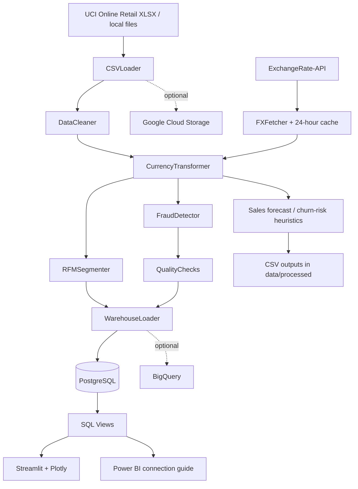

# FinanceETL — Financial Data Engineering Platform

An end-to-end financial data engineering project that transforms retail transaction data into analytics-ready datasets. It combines modular Python ETL components, foreign-exchange rate retrieval with local caching, a PostgreSQL dimensional warehouse, RFM customer segmentation, rule-based transaction anomaly flags, predictive analytics, and a Streamlit dashboard. Optional code paths support Google Cloud Storage and BigQuery.

> **Project scope:** This is a portfolio / learning project using the UCI Online Retail dataset. Its CDC behavior is simulated by splitting a dataset into batches; the anomaly rules are screening heuristics, not a production fraud system. Cloud and Airflow components require environment-specific configuration and should be validated before use.

## Contents

- [Architecture](#architecture)
- [Capabilities](#capabilities)
- [Data flow](#data-flow)
- [Technology stack](#technology-stack)
- [Repository layout](#repository-layout)
- [Quick start](#quick-start)
- [Configuration](#configuration)
- [Run the pipeline](#run-the-pipeline)
- [Analytics and warehouse](#analytics-and-warehouse)
- [Dashboard](#dashboard)
- [Tests and data quality](#tests-and-data-quality)
- [Optional Google Cloud integration](#optional-google-cloud-integration)
- [Airflow orchestration](#airflow-orchestration)
- [Current limitations and engineering notes](#current-limitations-and-engineering-notes)
- [License](#license)

## Architecture



The main orchestrator is `main.py`. It selects an execution mode, coordinates ingestion and transformations, runs quality checks, and loads records into PostgreSQL. Predictive outputs are generated in a separate mode and written to CSV for the dashboard to consume.

## Capabilities

### Ingestion and foreign exchange rates

- Downloads the UCI Online Retail Excel dataset when no supported local source file is found.
- Loads Excel and CSV inputs and removes exact duplicate rows after concatenation.
- Retrieves latest exchange rates using ExchangeRate-API, with a 24-hour local cache.
- Provides fallback development rates when no usable API key is configured or the API request fails.
- Contains a CDC simulator that chronologically splits records into an initial batch and an incremental batch.

### Transformation and customer analytics

- Filters rows without invoice or customer identifiers and removes non-positive quantities and prices for sales-focused analysis.
- Standardizes customer IDs, invoice dates, and selected text fields.
- Computes line revenue in GBP and derives USD, EUR, and MAD amounts using the configured rates.
- Calculates customer Recency, Frequency, and Monetary (RFM) metrics and assigns rule-based customer segments.
- Adds a transaction-level suspect flag using IQR-based revenue outliers, product-relative price checks, and same-customer daily invoice velocity.

### Predictive analytics

The optional `predict` mode includes two lightweight analytical components:

- **Revenue forecasting:** Fits a linear regression on historical daily revenue versus ordinal date and forecasts future daily revenue.
- **Churn-risk heuristic:** Derives a score from RFM recency and frequency scores and exports customers above a configured threshold.

These are baseline approaches intended to demonstrate a workflow. They are not validated financial forecasts or trained churn-classification models.

### Warehouse and BI

- SQLAlchemy models define `dim_date`, `dim_customer`, `dim_product`, and `fact_sales`.
- PostgreSQL DDL is provided under `sql/postgresql/`.
- SQL views provide sales-by-country, current customer profile, and flagged-transaction reporting.
- The Streamlit dashboard visualizes headline revenue/order/customer KPIs, sales by country, RFM segments, and optional prediction CSVs.
- A Power BI connection and visualization guide is available in `dashboards/powerbi/README.md`.

### Optional cloud code

- The GCP loader contains Google Cloud Storage upload and BigQuery load paths.
- The BigQuery schema DDL is in `sql/bigquery/init_schema_bq.sql`.
- An Airflow DAG definition is included under `dags/`; it needs environment-specific path and runtime configuration before it can run outside the original development environment.

## Data flow

1. **Read source data:** `CSVLoader` checks configured raw-data folders, loads supported Excel/CSV files, and downloads the default dataset if no files are found.
2. **Get FX rates:** `FXFetcher` reads an unexpired cache or requests current rates, then falls back to development rates if needed.
3. **Clean records:** `DataCleaner` filters and normalizes retail transaction rows.
4. **Enrich revenue:** `CurrencyTransformer` calculates GBP line revenue and converted monetary columns.
5. **Derive customer segments:** `RFMSegmenter` aggregates transactions by customer and assigns RFM scores/labels.
6. **Flag anomalies:** `FraudDetector` adds `Is_Fraud_Suspect` for transaction rows matching one or more rules.
7. **Validate:** `QualityChecks` checks required columns, non-positive quantities/revenue, future dates, and selected currency integrity.
8. **Load:** `WarehouseLoader` updates dimensions and appends fact records to PostgreSQL.
9. **Explore:** SQL views and the Streamlit dashboard expose the warehouse results; prediction outputs can be generated separately.

## Technology stack

| Area | Tools |
|---|---|
| Language and data processing | Python, pandas, NumPy |
| External API | requests, ExchangeRate-API |
| Configuration and logging | python-dotenv, pydantic-settings, Loguru |
| Warehouse access | SQLAlchemy, PostgreSQL, psycopg2 |
| Analytics | scikit-learn, RFM scoring, rule-based anomaly detection |
| Dashboard | Streamlit, Plotly |
| Cloud integration (optional) | Google Cloud Storage, BigQuery |
| Tests | pytest |
| Local infrastructure | Docker Compose, PostgreSQL |
| Workflow definition (optional) | Apache Airflow |
| Task shortcuts | Make |

## Repository layout

```text
FinanceETL/
├── config/                 # Settings and logging setup
├── data/
│   ├── raw/                # Retail source files
│   └── processed/          # FX cache and prediction outputs
├── dags/
│   └── finance_etl_dag.py  # Airflow DAG (requires local configuration)
├── dashboards/
│   ├── app.py              # Streamlit + Plotly dashboard
│   └── powerbi/README.md   # Power BI setup guide
├── gcp/                    # Cloud deployment notes
├── sql/
│   ├── postgresql/         # PostgreSQL tables and views
│   └── bigquery/           # BigQuery schema
├── src/
│   ├── analytics/          # Revenue forecast and churn-risk score
│   ├── ingestion/          # Source loading, FX retrieval, CDC simulation
│   ├── quality/            # Data quality checks
│   ├── transformation/     # Cleaning, currency, RFM, anomaly detection
│   └── warehouse/          # SQLAlchemy models and database/cloud loaders
├── tests/                  # Transformation tests
├── main.py                 # CLI orchestrator
├── Makefile                # Common developer commands
├── requirements.txt        # Python dependencies
├── .env.example            # Example environment configuration
└── FINAL_REPORT.md         # Project abstract and presentation outline
```

## Quick start

### Prerequisites

- Python version compatible with the dependencies (Python 3.10+ is a reasonable starting point; verify your local environment).
- Docker and Docker Compose for the PostgreSQL container.
- GNU Make for the provided shortcuts, or run the corresponding commands manually.
- An ExchangeRate-API key for live FX rates. Without one, the code uses configured fallback rates.

### 1. Clone the repository

```bash
git clone https://github.com/adamfutur/FinanceETL.git
cd FinanceETL
```

### 2. Create and activate a virtual environment

Linux/macOS:

```bash
python -m venv .venv
source .venv/bin/activate
```

Windows PowerShell:

```powershell
python -m venv .venv
.venv\Scripts\Activate.ps1
```

### 3. Install dependencies and create local configuration

```bash
python -m pip install --upgrade pip
pip install -r requirements.txt
cp .env.example .env
```

On Windows, copy the configuration with:

```powershell
Copy-Item .env.example .env
```

Edit `.env` and add your API key if you want live FX rates. Do not commit `.env` or service-account files.

### 4. Start PostgreSQL

```bash
docker-compose up -d
```

The supplied Compose file exposes PostgreSQL on port `5432` and creates the `finance_db` database. The default credentials are for local development only; change them before any shared or deployed use.

### 5. Run the full ETL

```bash
python main.py --step full
```

Or use the Makefile shortcut:

```bash
make etl
```

The first full run initializes the SQLAlchemy schema and loads dimension and fact data. Review the logs and quality-check output to confirm completion.

## Configuration

Settings are defined in `config/settings.py` and `.env.example`.

| Variable | Purpose | Example |
|---|---|---|
| `EXCHANGE_RATE_API_KEY` | API credential; fallback rates are used if absent/invalid | Set your own key |
| `BASE_CURRENCY` | Base used by FX request | `GBP` |
| `POSTGRES_USER` | PostgreSQL user | `postgres` |
| `POSTGRES_PASSWORD` | Local database password | `postgres` for local development only |
| `POSTGRES_DB` | Database name | `finance_db` |
| `POSTGRES_HOST` | Database hostname | `localhost` from host machine |
| `POSTGRES_PORT` | Database port | `5432` |
| `GCP_PROJECT_ID` | Google Cloud project (optional) | Your project ID |
| `GCP_DATASET_ID` | BigQuery dataset (optional) | `finance_dw` |
| `GCP_BUCKET_NAME` | GCS bucket for raw-data upload (optional) | Your bucket |
| `GCP_SERVICE_ACCOUNT_JSON` | Service-account JSON path read by the current GCP loader | Local credential file path |
| `LOG_LEVEL` | Intended logging level setting | `INFO` |

Note: the current GCP loader reads `GCP_SERVICE_ACCOUNT_JSON` directly from the environment. Set that variable when configuring service-account authentication; `GOOGLE_APPLICATION_CREDENTIALS` alone is not used by that loader's current credential-path check.

## Run the pipeline

The command-line interface is defined in `main.py`.

| Command | Purpose |
|---|---|
| `python main.py --step full` or `make etl` | Run ingestion, transformations, checks, and warehouse load |
| `python main.py --step cdc` or `make cdc` | Process the chronological initial/incremental batch simulation |
| `python main.py --step predict` or `make predict` | Generate revenue forecasts and churn-risk CSVs |
| `python main.py --step dashboard` or `make dashboard` | Launch Streamlit |
| `python main.py --step ingest` | Load source data and fetch FX rates |
| `make up` / `make down` | Start / stop the local PostgreSQL container |
| `make test` | **Currently wired to `main.py --step test`, but that CLI option is not defined. Use `pytest` directly until the Makefile/CLI target is fixed.** |

Additional caution: `transform` and `load` are accepted as CLI choices, but the current orchestrator reloads source data for those modes rather than consuming a persisted intermediate dataset. The code should be updated before treating them as independent, staged production jobs.

### CDC behavior

The CDC simulator sorts input records by `InvoiceDate`, assigns the first 80% to an initial batch and the remaining 20% to an incremental batch, and labels both batches as `INSERT`. It is useful for demonstrating batch partitioning, but it does not detect real source-level inserts/updates/deletes.

## Analytics and warehouse

### Multi-currency measures

The transformer calculates line revenue as:

```text
Total_GBP = Quantity × UnitPrice
Total_<currency> = Total_GBP × exchange_rate
```

The configured base is GBP. The current FX integration retrieves the latest available rates rather than historical rate data for each transaction date, so converted values are illustrative analytics rather than auditable historical accounting valuations. For accounting-quality reporting, use rates matched to transaction dates and clearly specify rate conventions.

### RFM customer segmentation

For each customer, the pipeline calculates:

- **Recency:** number of days between the customer's most recent invoice and the dataset's latest invoice date plus one day.
- **Frequency:** number of distinct invoices.
- **Monetary:** sum of GBP line revenue.

Quantile-based scores are combined into a segment score and labels including Best Customers, Loyal Customers, Big Spenders, Potential Loyalists, Lost Customers, At Risk, and Recent Customers.

### Rule-based anomaly flags

A transaction is flagged if it matches one or more of the following current rules:

- GBP transaction value exceeds the upper IQR-based limit (Q3 + 3 × IQR).
- Unit price is more than twice the observed mean price for the same stock code.
- Customer has more than ten distinct invoices on the same calendar day.

These checks are explainable heuristics. They can flag legitimate unusual activity and should not be interpreted as proof of fraud.

### Predictive outputs

The prediction mode writes:

- `data/processed/sales_forecast.csv`
- `data/processed/churn_risk.csv`

Revenue is forecast using linear regression on daily revenue and date ordinal. The churn-risk score is a heuristic derived from RFM recency and frequency scores. These outputs are suitable for demonstrations, not validated forecasts or calibrated risk estimates.

### Warehouse tables and views

The SQLAlchemy model and PostgreSQL schema define:

- `dim_date`: date attributes such as day, month, quarter, year, weekend.
- `dim_customer`: customer country and latest RFM segment/score.
- `dim_product`: product description and unit price.
- `fact_sales`: invoice-line measures in GBP, USD, EUR, and MAD plus suspect flag.

SQL views in `sql/postgresql/views.sql` include:

- `v_sales_by_country`
- `v_customer_profiles`
- `v_fraud_report`

The current loader appends fact rows and refreshes the customer dimension. Re-running the full pipeline can therefore duplicate fact rows; use a fresh local database for a clean demonstration, or implement a stable fact key and idempotent upsert logic before relying on repeatable production runs.

## Dashboard

Launch the dashboard after loading data into PostgreSQL:

```bash
make dashboard
```

The Streamlit dashboard uses Plotly and currently includes:

- Total revenue (GBP)
- Distinct invoice count
- Distinct customer count
- Average order value
- Revenue by country
- Customer RFM segment counts
- Optional sales forecast and churn-risk views when prediction CSVs are present

The dashboard connects using a hard-coded local development PostgreSQL URL in `dashboards/app.py`. Update it to read environment-based connection settings before deploying outside a local development environment.

## Tests and data quality

Run the tests directly:

```bash
pytest
```

The repository currently includes tests covering cleaning, currency conversion, RFM segmentation, and one fraud-flagging case. The pipeline's quality checks verify critical nulls, non-positive quantities/revenue, future dates, and one currency-conversion condition; duplicate invoice/product combinations produce warnings rather than automatic failure.

Test coverage is a starting point and does not yet constitute full end-to-end validation of database loads, API failures, CDC retries, or cloud uploads.

## Optional Google Cloud integration

The repository includes a GCP loader with code paths for uploading raw data to Google Cloud Storage and loading tables into BigQuery.

1. Create a Google Cloud project and enable the required services.
2. Create a service account with minimum required permissions.
3. Set `GCP_PROJECT_ID`, `GCP_DATASET_ID`, `GCP_BUCKET_NAME`, and `GCP_SERVICE_ACCOUNT_JSON` in your local environment.
4. Configure the bucket and dataset, and review `sql/bigquery/init_schema_bq.sql` before running cloud loads.

The current BigQuery DDL uses the placeholder project `your_project`. Replace it with your project and dataset names before execution. Cloud schema/loading paths should be tested against your target BigQuery dataset: the current loader's payload columns are not a full, explicit mapping of every PostgreSQL warehouse table.

Do not commit service-account JSON files or production credentials.

## Airflow orchestration

A DAG definition is included at `dags/finance_etl_dag.py`, with the intended task order:

`ingest_data → transform_and_analyze → load_to_data_warehouse`

**The current DAG requires changes before use:** its Bash commands contain a machine-specific Windows path (`C:/Users/MSI/Desktop/FinanceETLHub`), it uses task modes that currently do not share persisted intermediate output, and Airflow is not listed in `requirements.txt`. Configure the project path and Python environment for your Airflow worker, install a compatible Airflow version separately, and validate task behavior before scheduling.

## Current limitations and engineering notes

- **CDC is simulated:** there is no source log/offset-based capture of actual updates or deletes.
- **Repeated runs are not idempotent:** fact loads append rows without a demonstrated stable-key deduplication step.
- **FX rates are latest-rate based:** the project does not currently demonstrate transaction-date historical exchange rates.
- **Anomaly detection is rule-based:** flags are for review and have not been validated as fraud classifications.
- **Forecasting is a baseline:** the linear trend model does not demonstrate holdout evaluation, uncertainty intervals, or seasonality modeling.
- **Cloud integration is optional and needs deployment validation:** credentials, dataset names, IAM, and schema mapping must match the target environment.
- **Airflow configuration is environment-specific:** the committed DAG contains a local Windows path.
- **Local database credentials are development defaults:** change them for any shared deployment.
- **The input loader contains a hard-coded extra Windows data directory:** `src/ingestion/csv_loader.py` should be configured through environment variables or removed for portable execution.

These limitations are useful next engineering milestones and are documented here so users can evaluate the project accurately.

## Future improvements

- Make data loading idempotent with a stable transaction-line key and upsert/merge logic.
- Introduce persistent CDC watermarks and real update/delete semantics.
- Add historical FX rates keyed by transaction date.
- Externalize paths and dashboard/database URLs into configuration.
- Repair CLI modes and Makefile test wiring; persist intermediate artifacts if staged steps are intended.
- Add integration tests with a disposable PostgreSQL instance and mocked FX API responses.
- Add CI with linting, tests, and dependency/security checks.
- Improve cloud table mapping, configuration validation, and retry/error reporting.
- Make the Airflow DAG portable and deployable through a reproducible environment.

## License

See [LICENSE](LICENSE) for the license terms.

---

**Author:** Adam IMLOUL  
**Repository:** [github.com/adamfutur/FinanceETL](https://github.com/adamfutur/FinanceETL)
